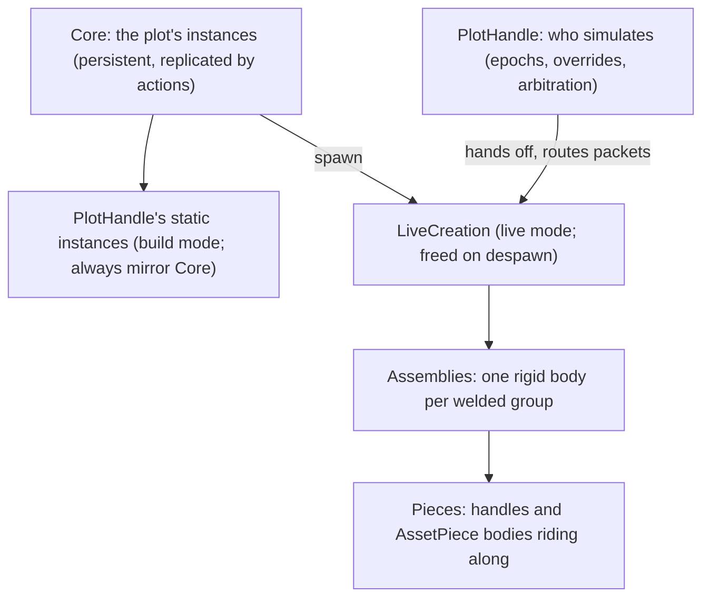

# Live Creations

How spawned creations work today, from welding to replication ([**section 1**](#1-how-it-works-today) walks through
it), and the design for what comes next: asset logic, mechanisms, input, seats, and aerodynamics. The
[**roadmap**](./ROADMAP.md#live-physics) tracks its progress. Decisions are numbered **(D#)**; the table at the end
lists them, resolved or open. Plans are a guide, not a contract: they bend when something unforeseen comes up.

> [!NOTE]
> Ensemble moves fast, and this document may trail the code. Where they disagree, the code is right, and the
> document is due a fix.

---

## Terms

| Term             | Meaning                                                                                    |
|------------------|--------------------------------------------------------------------------------------------|
| Creation         | A plot's build as a whole, static or live (as in saves)                                    |
| Instance         | One placed asset in Core: ID, asset, grid position, rotation, properties                   |
| Static instances | Build mode: frozen AssetHandles under `Instances/Static`, editable with the tools          |
| Spawned / live   | A plot whose creation is simulated, as a `LiveCreation`; editing is locked                 |
| Abut             | Two collider boxes share part of a face within `Epsilon`; edges and corners don't count    |
| Weld             | An automatic, unbreakable rigid link between pieces of two instances whose boxes abut      |
| Group            | The pieces connected by welds (one union-find component), even a single piece              |
| Assembly         | The `RigidBody3D` built for one group; its ID is the group's index in weld order           |
| Piece            | An asset's own colliders (piece 0) or an `AssetPiece` child, riding its group's assembly   |
| Mechanism        | (Later) Assemblies linked by joints; one plot's always share its simulator                 |
| Owner            | The peer that simulates a mechanism; the plot's owner by default (network ownership)       |
| Proxy            | An assembly on a peer that doesn't simulate it: frozen, kinematic, moved by received state |
| Hand-off         | Ownership moving to another peer, which resumes simulating from the last received state    |
| Anchor           | (Later) An asset that freezes its assembly while any anchor holds it                       |
| Passenger        | (Later, name TBD) A character seated in a creation                                         |

## 1. How it works today

A plot has two modes. In **build mode**, its instances are frozen asset scenes that players place and edit. In **live
mode**, after spawning, they become physics: a `LiveCreation` that exists only until the plot despawns, so
nothing of a spawn outlives it.

### The life of a creation

1. **Building.** Players place instances with actions, Core stores them, and each `PlotHandle` mirrors them as frozen
   `AssetHandle` scenes (under `Instances/Static`), which the tools select and characters stand on.
2. **Spawning.** The owner sends `SetPlotSpawnedAction`, and every peer, alike and on its own (no geometry is sent),
   hides the static mirror and creates a `LiveCreation`. It welds every piece whose collider boxes share a face with
   another instance's piece (`Welds`), builds one `Assembly` (a `RigidBody3D`) per welded group with its origin on its
   center of mass, moves each piece into its assembly, links the assets' joints between assemblies, and initializes
   the handles and their components. An assembly's ID is its group's index, so every peer agrees on IDs.
3. **Who simulates.** One peer simulates each creation, and everyone else shows proxies: frozen kinematic copies that
   characters can still stand on. The host decides: an override if any (from Lua, or a timeout), else the arbitrated
   simulator (step 6), else the plot's owner, else itself, and it broadcasts each change with an epoch number. A
   change hands the creation off: the new simulator unfreezes its proxies where they last were, and the old one
   freezes its bodies into proxies.
4. **Streaming.** The simulator sends its moving assemblies 20 times a second, bit-packed (about 25 bytes each),
   through the host, which checks and rate limits every packet before relaying it. Sleeping assemblies are resent
   about once a second, in case their final update was lost.
5. **Proxies.** Each peer replays the received states 100 ms in the past, along curves through the positions and
   velocities, so late or lost packets don't show.
6. **Arbitration.** When creations of different plots come close, the host hands them all to one simulator (that of
   the creation with the most assemblies), so their collisions are real physics on one machine, until they've been
   apart for 2 s.
7. **Despawning.** The owner despawns, or the last occupant leaves. Every peer wakes other creations' bodies that
   rested on this one, frees the `LiveCreation` (and with it every assembly and stream buffer), and shows the static
   mirror again.

Late joiners get each plot's epoch, simulator, and every assembly's latest state in the plots snapshot, so their
proxies start in place.

### Where the code lives

| Path                                | Role                                                                           |
|-------------------------------------|--------------------------------------------------------------------------------|
| `Scripts/Plots/PlotHandle.cs`       | A plot, with `Impl/PlotHandle.*.cs`: the static mirror (`Instances`), spawning |
|                                     | (`Spawning`), who simulates (`Simulation`, `Arbitration`), and packets and     |
|                                     | late joins (`Replication`)                                                     |
| `Scripts/Plots/PlotManager.cs`      | All plots, and the host's arbitration between them                             |
|                                     | (`Impl/PlotManager.Arbitration.cs`)                                            |
| `Scripts/Plots/Impl/Placement/`     | Oriented boxes (`Obb`), their grid, and the placement rules and solver         |
| `Scripts/Creations/LiveCreation.cs` | A spawned creation, with `Impl/LiveCreation.*.cs`: building (`Building`),      |
|                                     | streaming and proxies (`Streaming`), and arbitration spheres and waking        |
|                                     | (`Neighbors`)                                                                  |
| `Scripts/Creations/Assembly.cs`     | One rigid body per welded group, with its proxy replay                         |
|                                     | (`Impl/Assembly.Proxy.cs`)                                                     |
| `Scripts/Creations/Impl/`           | Weld groups (`Welds`), arbitration spheres, and the wire format (`Packets/`)   |
| `Scripts/Assets/`                   | `AssetHandle` (an asset's root and piece 0), `AssetPiece`, `AssetComponent`,   |
|                                     | and `AssetManager` (each piece's colliders, bounds, and mass); `Components/`,  |
|                                     | `Materials/`                                                                   |
| `build_assets/`                     | The asset scenes, with asset scripts beside them (`Advanced/Suspension.cs`)    |
| `shaders/helix.gdshader`            | The spring coil (a helix)                                                      |

## 2. Principles

- **Core stays pure.** Live state (bodies, ownership, inputs, seats) is ephemeral: it lives in Scripts and Replication,
  and despawning discards it. Only build state (instances and their properties) is persistent and replicated by
  actions.
- **The engine is generic; assets are specific.** Scripts knows `AssetHandle`, `AssetComponent`, `Assembly`, and a few
  interfaces, never a concrete asset. Concrete assets depend on the engine, never the reverse, and NsDepCop enforces
  it, kept strict and up to date.
- **Pay only for what you use.** Assets opt in to engine services through interfaces. A block with no logic costs no
  ticks, checks, or allocations, and an asset that opts in gets exactly what it asked for, nothing more.
- **One interop call per body, not per asset.** Per-tick work reads each assembly's state once, works in C#, and
  writes once (as the ConstructTool's cached `ObbGrid` did for placement).
- **The network is the most important optimization.** Live state is bit-packed and quantized, and only what changed
  is sent.
- **Nodes added at run time get explicit names,** never Godot's generated ones.
- **Baja Builders parity for behavior,** improved where Godot allows.

## 3. Asset authoring

### Where asset scripts live

- Engine-provided, reusable components stay in `Scripts/Assets/Components/` (e.g., `Paintable`, later `Seat`,
  `Airfoil`, `Anchor`).
- Asset-specific scripts sit beside their scene in `build_assets/`: `build_assets/Advanced/Suspension.tscn` and
  `Suspension.cs`. Godot requires a script's file name to match its class, and asset scenes are PascalCase **(D1)**, so
  every `X.cs` pairs with its `X.tscn`. `AssetManager` only registers scenes, so the scripts don't disturb its scan.
- `EnsembleGame.csproj` nests each script under the same-named `.tscn` or `.scn` beside it in the IDE, as `.axaml.cs`
  nests under `.axaml` (the scenes are `None` items, so they can parent), and `config.nsdepcop` lets nothing but
  `EnsembleRoot.BuildAssets.*` reference an asset script.

### Behaviors: components or subclasses

Reusable behaviors are `AssetComponent` nodes dropped under the handle and configured by exports; unique assets (motor,
servo, piston) subclass `AssetHandle`. Both get `Initialize` once their creation exists, and a handle lives in
one mode (build or live) for its whole life.

### Multi-piece assets (motors, hinges, pistons, suspension; done in 0.56.0)

An asset can have several rigid **pieces** that move independently, like a suspension's top and bottom, authored
much as Baja Builders did it (a model, two parts, and a constraint):

- The handle (a `StaticBody3D`) has its direct colliders as piece 0. Each `AssetPiece` child (also a `StaticBody3D`)
  is another piece, with its own direct colliders and meshes. Neither ever moves in build mode.
- Welding works per piece: the weld parts are (instance, piece) pairs, and an asset's pieces never weld to each other
  (as in BB, where motors kept their head and base apart), though other parts may join them into one group.
- A joint is an ordinary Godot joint node, a direct child of the handle, whose nodes are the handle or its pieces,
  with every setting (springs, limits, motors) in the inspector. The handle collects its pieces and joints as it's
  instantiated and unlinks the joints, so no build or preview links bodies; a live creation relinks each joint to its
  pieces' assemblies, at the joint's place, once every assembly is in the tree.
- At spawn, each piece with colliders is reparented into its own group's assembly; the handle rides its first welded
  piece's (its own, unless it has no colliders), and pieces without colliders ride with it. The handle keeps
  references to its pieces, so components never walk the tree after reparenting.
- If a loop of welds puts both of a joint's pieces in one assembly, the joint would link a body to itself; it's
  skipped with a warning, as BB builds simply locked up.
- `AssetManager` warns at startup about anything spawning would ignore: bodies other than `AssetPiece` children, joints
  elsewhere than under the handle, and joints that don't link two of the asset's pieces.

### Asset scripts and properties

- An asset with behavior subclasses `AssetHandle` in a script beside its scene (`build_assets/Advanced/Suspension.cs`,
  namespace `EnsembleRoot.BuildAssets.Advanced`). NsDepCop lets nothing outside `EnsembleRoot.BuildAssets` reference an
  asset script, so the engine never depends on a concrete asset.
- **Properties** are the asset's defaults (the handle's `Properties` export), copied into each instance and edited per
  instance by actions (later, by the PropertyTool). Keys starting with `_` are the engine's (`_colorHex`,
  `_materialId`); the others are the asset's own. `SetPropertiesAction` only checks that a key exists, keeps its type,
  and is finite, so **each asset clamps what it reads** to what it supports (`AssetHandle.GetNumberProperty(key, min,
  max)`): any stored value is safe, and the limits live with the code that knows them.
- Exported node references (`[Export] public Node3D CoilEnd`) are resolved when the scene is instantiated, so they stay
  valid however a live creation reparents the pieces; never look them up in the tree later.
- A handle lives one of two lives, static (build mode) or live (`IsLive`), and previews are never initialized.

### Example: the Suspension

- Two plates, `Bottom` and `Top`, both `AssetPiece`s, each welding to its own neighbors. The handle has no colliders of
  its own, so it rides the bottom plate's assembly.
- `Spring`, a `Generic6DOFJoint3D` between them: its Y axis is a spring with travel limits, and every other axis is
  locked (a 6DOF axis's limits default to 0 to 0).
- `Suspension.cs` sets the spring from the instance's properties when live, clamped: `stiffness` (0 to 100,000 N/m),
  `damping` (0 to 10,000 N s/m), `targetLength` (its rest length, end to end), and `maxLength` (up to 2 m end to end);
  the plates never come closer than 0.1 m.
- `Coil`, a cylinder bent into a helix by `shaders/helix.gdshader`, stands on the bottom plate and reaches `Coil End`,
  a marker on the top plate. Its color, turns, helix radius, and tube thickness are material parameters, and its length
  an instance parameter, so each coil stretches on its own with one shared material. While live, the script sets the
  length every frame from where the plates are drawn.

### Materials (the material bank)

- A `MaterialBank` node under Main with a static `Instance` (no `Globals` accessor), exporting an array of
  `AssetMaterial` resources edited in the inspector. An asset's `_materialId` indexes it; `-1` (matching `Sentinels`)
  means none, the plain color. Painted materials are shared per material and color (`Paints`), so painted geometry
  still batches.
- **(D5)** An `AssetMaterial` holds the look (`Look`, any `BaseMaterial3D` template, its albedo tinted by the
  instance's color) and the physics (`Density`, `Friction`, `Bounce`), so `Paintable` and the mass calculation read the
  same entry: rocks sink, wood floats, rubber grips, and ice slips. An instance without a material uses its asset's
  `Density`.
- **(D6)** ID 0 is the debug checkerboard (`resources/materials/Debug.tres`, today's look), so existing
  `_materialId = 0` instances keep their look, and new plain assets default to `-1`.
- An assembly has one physics material (Godot sets them per body), blended from its members' (mass-weighted friction,
  minimum bounce). Wheels get grip by being their own assemblies on joints.

## 4. Physics authority

### Model

- Every mechanism has exactly one **simulator** peer. Everyone else shows proxies: frozen kinematic bodies moved by
  received state, which local characters still collide with and stand on.
- **Default:** a creation's simulator is its plot's owner, else the host. The host alone decides and broadcasts each
  change with its epoch, rather than every peer deriving it: one departure can change the owner and clear an override
  at once, and peers handling those in another order would count different epochs.
- **Overrides:** the host alone sets them, per plot for now (`PlotHandle.SetSimulatorOverride`, Lua
  `set_plot_simulator`), and the host is always the fallback. An override lasts until the plot's owner changes, the
  plot despawns, or its peer leaves. Overrides are live state, so they're RPCs from the host, not Core actions.
  Per-mechanism overrides come with mechanisms.
- **Epochs:** each plot has an ownership epoch. Every peer bumps it on spawning and despawning; hand-offs take the
  host's. State packets carry it, and peers drop packets with another epoch or from the wrong sender (the host only
  accepts the simulator's), so a late packet from a previous simulator can never move a body.

### Hand-off

1. The host decides (owner left, override set or cleared, timeout), bumps the epoch, and broadcasts the new simulator
   with it (`RpcSetSimulator`, reliable, to synced peers).
2. The old simulator, on receipt, freezes its bodies into proxies where they are; they hold still until the new
   simulator's states arrive.
3. The new simulator unfreezes its proxies from their latest received state, brought forward to the present, with its
   velocities; bodies that were at rest start asleep, so a hand-off doesn't wake a whole creation. Then it streams.
4. Remaining proxies forget their timeline (another simulator's sequence numbers mean other moments).
5. Until the change reaches everyone, both may simulate briefly; the epoch keeps only the new one's packets.

### Edge cases

- **Owner leaves:** the plot's new owner becomes the default simulator. An empty plot despawns (existing rule), so the
  host fallback only matters for overrides and for owners that stop sending.
- **Simulator stops sending:** simulators send at least a header-only heartbeat a second, and the host takes over a
  creation it heard nothing about for 3 s, as an override (so a flaky connection can't flip it back and forth).
- **Owner lags or cheats:** sessions are invite-only, so checks stay light: the codec only carries finite, bounded
  values (+-16 km, +-256 m/s); the host decodes every packet before relaying it (plot, epoch, at most one packet's
  states) and rate limits relays to 1.5 times what the creation's size lets a simulator send.
- **Despawn mid-hand-off:** every peer frees the creation, and pending packets for it are dropped (no such creation).
- **Late joiners:** `PlotsSnapshot` carries each plot's epoch, simulator, and the latest state of every assembly,
  moving or asleep, so proxies start exactly in place (later: seated characters and controller input).
- **Lost packets for sleeping bodies:** a body's last update before sleeping may be lost, so sleeping assemblies get a
  slow round-robin keepalive, each about once a second but at most 40 a second per plot, healing stale proxies
  without scaling bandwidth with creation size (a flat 40 a second made a one-body creation resend itself 40 times).
- **Support despawning:** Jolt leaves bodies asleep when what they rest on leaves the space, and a body handed off at
  rest starts asleep, so a tower propped against a creation that despawned kept leaning on nothing. Despawning wakes
  every peer's own sleeping bodies within the creation's bounds.

### Arbitration: shared simulators (0.55.0, done)

Collisions between bodies with different simulators are one-sided: each simulator sees the other creation as a
kinematic proxy, an immovable wall that arrives late. So when two creations with different simulators get close, the
host gives both to one simulator until they separate, and their collisions become real physics on one machine.

- **Detection, on the host only:** it already has every creation, as proxies or as bodies it simulates, and it
  decides. Every 1/8 s, while two or more plots are spawned, it puts a sphere around each assembly, its bounding
  sphere (half its colliders' bounds diagonal) times 1.5, so the hand-off happens before contact rather than during
  it. Each pair of creations is tested by their spheres' overall bounds first, then only the spheres within the other
  creation's bounds, stopping at the first touching pair (`ArbitrationSpheres`). Proxies' poses are known without
  asking Godot, so only bodies the host simulates cost a read each.
- **Why not areas:** Godot areas were measured first, on 1,462 loose cubes. An `Area3D` per assembly made Jolt track
  every overlap within the creation itself (settled physics went from 0.8 ms to as much as 22 ms a frame), and one
  area per plot, with a sphere shape per assembly, rebuilt its whole compound shape whenever a sphere moved (up to
  260 ms a frame while the pile settled). The tests in C# cost about 0.05 ms a frame on the same pile.
- **Groups:** creations whose spheres overlap link their plots, and linked plots join with union-find
  (`Arbitration.GetLeaders`), so three creations in a pile share one simulator. Each group goes to the simulator its
  creation with the most assemblies has apart from arbitration (**D9**), which already carries the heaviest load, so
  the work stays spread across players rather than piling onto the host; the others get it as their arbitrated
  simulator, through the same broadcast as any hand-off.
- **Release with hysteresis:** a link holds for 2 s after its creations part, and arbitration moves a plot at most
  once every 2 s, so creations jostling at the edge don't flap between machines.
- **Precedence:** a manual or timeout override beats arbitration, which beats the plot's owner. Despawning ends a
  plot's links at once, and a departing simulator loses the arbitrations it held; an owner change only changes whom
  its group goes to.
- **Cost:** nothing in single-player or with fewer than two spawned plots. Otherwise, creations far apart cost a
  bounds test each review, and 1,462 bodies the host simulates cost about 0.4 ms a review, mostly reading their
  transforms.

## 5. Replication

- One unreliable-ordered RPC per plot per tick from the simulator (channel 2; characters use 1), relayed by the host
  to synced peers, as with characters.
- **Bit-packed, not byte-aligned.** Header: plot ID, epoch, sequence. Per moving assembly: ID (its group's index in
  weld order), position (1/512 m, relative to the plot), rotation (smallest three), and linear and angular velocity (see
  the bit budget below).
- An assembly's origin is its center of mass, so its position and velocities describe the point it rotates about (with
  the plot's origin, proxies extrapolating a rolling ball swung it meters off course).
- Sleeping assemblies send nothing beyond the keepalive round-robin (section 4).
- **Budget:** at most 256 states per plot per stream (about 130 KB/s per receiver); past it, awake assemblies take
  turns, each sent less often, and bodies that just fell asleep go first.
- **Proxies replay 100 ms behind:** each state is stamped with the simulator's moment (sequence numbers advance every
  stream tick, a whole number of physics ticks) on a local timeline that follows the earliest arrivals. Proxies follow
  a Hermite curve through the buffered positions and velocities (straight across impacts, so nothing dips into what
  it hit), spin rotations by their angular velocities, extrapolate at most 1/10 s when a state is late, and snap when
  far off. Snaps use the space hop (see the Jolt kinematic note), or a snapping proxy would shove nearby bodies.
- **Testing:** Lua `set_net_sim(latency_ms?, jitter_ms?, loss?)` delays (in order) and drops this peer's incoming
  live state, creations and characters, to try poor connections without outside players.
- Input masks: unreliable full masks on change plus a few repeats a second while held, controller -> host ->
  simulator.
- Seats: reliable sit / leave messages; seated characters stop sending positions.

Bit budget per moving assembly (204 bits, about 25.5 bytes; header: plot ID 8 bits, epoch 16, sequence 16, count 16):

| Field            | Encoding                                                          | Bits |
|------------------|-------------------------------------------------------------------|------|
| Assembly ID      | The group's index in weld order                                   | 16   |
| Position         | Fixed point relative to the plot origin: 1/512 m steps, +-16384 m | 72   |
| Rotation         | Smallest three: 2-bit index, 3 x 10 bits                          | 32   |
| Linear velocity  | 1/32 m/s steps, +-256 m/s (the host's speed cap)                  | 42   |
| Angular velocity | 1/32 rad/s steps, +-256 rad/s (a fast wheel spins past 100 rad/s) | 42   |

## 6. Asset logic at runtime (planned)

### Ticks

- Opt-in interfaces, not base classes, so a wing component can sit on any asset:
    - `ISimulationTicked.SimulationTick(in SimulationTick tick)` - physics logic (motors, forces, aerodynamics). Runs
      only on the peer simulating the asset's mechanism, at 100 Hz, from one loop per plot in instance-ID order. Not
      simulating means not ticked, so assets never check ownership themselves.
    - Plain Godot `_Process` for visuals on every peer (lights, effects). Normal Godot callbacks stay available, but
      heavy per-tick work belongs in the simulation tick.
- The tick argument carries the infrastructure (body state, force accumulator, input, delta), so an asset implements
  one method and writes no plumbing.
- `LiveCreation` collects the ticked handles and components once at spawn, so 1000 motors cost one engine callback plus
  1000 C# calls per tick.

### State and forces

- `SimulationTick` exposes the assembly's state, read once per tick per assembly: transform, linear and angular
  velocity, center of mass.
- Forces go into a per-assembly C# accumulator (`tick.AddForce(force, position)`, `AddTorque`), flushed with one
  `ApplyForce` / `ApplyTorque` per assembly per tick. A thousand wings make a thousand C# additions, not a thousand
  interop calls.
- Joint motors are driven through their joint (target velocity, max torque), set only when a value changes.

### Ownership-dependent state

Live asset state (a servo's target, a motor's throttle) is derived from inputs and physics, so a new simulator rebuilds
it on hand-off. Anything that must survive a hand-off travels in the replication stream (section 5); nothing else is
promised.

## 7. Mechanisms and joints

Most mechanisms only make sense with input, so they come after it; free hinges and springs (suspension) don't need it
and may come earlier. Some glitching may be accepted at first.

- A **mechanism** is a set of assemblies linked by joints. A joint can't span two machines, but each plot's creation
  has one simulator (and arbitration merges close plots), so no joint ever does; mechanisms only matter once
  simulators can differ within a plot.
- Joint mapping in Godot with Jolt (the 6DOF spring, limits, and equilibrium point were verified in a prototype: a
  spring sags exactly m g / k, and a limit left at 0 to 0 locks its axis):

| Asset      | Joint                                      | Driven by                                             |
|------------|--------------------------------------------|-------------------------------------------------------|
| Hinge      | `HingeJoint3D`, free                       | -                                                     |
| Motor      | `HingeJoint3D` with its motor              | Input sets the target velocity; max torque from props |
| Servo      | `HingeJoint3D` with its motor and limits   | A P-controller in the simulation tick toward a target |
| Piston     | `Generic6DOFJoint3D`, one linear axis      | A linear motor toward an extension target             |
| Suspension | `Generic6DOFJoint3D`, a linear spring axis | Authored stiffness, damping, and travel (done)        |

- Strengths are asset properties (non-underscore, so the future PropertyTool edits them), scaled for the default
  density (125 kg/m3).
- Joint stability suffers at large mass ratios (a 15 kg wheel on a 3 t car is 200:1). Mitigations: material densities
  for wheels, more Jolt solver iterations, and testing early.

## 8. Input (planned)

- **Controller:** each spawned plot has at most one, chosen by occupant order among the plot's occupants sitting in
  control seats, not by who sat down first. The owner is always the oldest occupant, so a seated owner always has
  control. Players who don't occupy the plot never get control. No controller means no input.
- **Input state:** the controller's pressed keys (Godot `Key`s; mouse buttons stay with the camera), from a fixed
  table of up to 64 bindable keys (letters, digits, arrows, Space, Shift, ...), as a 64-bit mask. Every send carries
  the whole state, so presses and releases are found by comparing with the previous mask: no start / stop bits or
  toggles, and a lost packet can't invert a key.
- **Bindings live on assets,** as editable properties suffixed `Key` (e.g., a motor's `forwardKey`, `reverseKey`), so
  the future PropertyTool knows to show them as key pickers. Values are Godot `Key` codes as integers: compact in saves
  and packets, shown by name in the UI (harder to hand-edit in JSON saves, an acceptable cost). Assets read
  `tick.Input.IsPressed(Key.Q)`.
- **Flow:** the controller samples its mask each physics tick (empty while the UI sinks input) and sends it to the
  host whenever it changes, plus a few times a second while any key is held, so a lost packet heals itself and a key
  can't stick. It's a custom RPC, not an action: it changes too often for the action rate limiter, and needs no
  validation beyond "the sender is the plot's current controller", which the host checks.
- **Who receives it (D8):** only the creation's **simulator**, via the host; it drives the physics (which way motors
  spin), not the plot owner as such. An asset whose look depends on input replicates that state itself (e.g., a glass
  that turns from water to wine sends a bool to the other peers), and visuals that follow physics (a spinning rotor)
  need nothing extra, since the proxies already move.
- While seated, the controller's character doesn't walk; the camera keeps mouse look and follows the seat.
- **Leaving a seat (D2):** the `character_seat_leave` action, defaulting to Space, consumed only when no seated asset
  binds Space; otherwise the action's own key.

## 9. Seats and characters (planned)

- A `Seat` component makes any asset a seat; its `HasControls` export makes it a control seat (the Chair and Control
  Chair assets).
- **Sitting (D3):** on touch, as with Roblox's seats in BB, with a short cooldown after leaving so you don't sit right
  back down. **Anyone may sit in any seat (D4),** but only the plot's occupants can control (section 8).
- **While seated,** the character's body leaves the physics space (the same hop as teleports), is parented to the
  seat's piece at its sit point, and its controller stops moving it. A seated character adds no weight, so a creation
  behaves the same with or without riders.
- **Leaving:** the body re-enters the space beside the seat (pushed clear of the creation like at spawn), and regains
  control.
- **Anything that moves or removes a seated character leaves the seat first:** teleports (H reset, `tp_char`,
  despawn's return to the plot, spawn clearing), despawning, the seat's assembly being killed, the occupant leaving or
  being kicked from the plot. `PlayerHandle.Teleport` calls `LeaveSeat()` before the hop, so every caller gets it.
- **Replication:** a seated character replicates its seat (plot ID, instance ID) instead of its position; every peer
  places it on its own copy of the seat, so it rides proxies smoothly.

### Characters versus creations (research)

Characters are kinematic: creations can't push them, a creation hitting one stops as if it hit a wall, and a walking
character may shove a creation (see the Jolt kinematic note). The goal is the reverse: creations push characters, and
characters never disturb creations. Godot's layers and masks can't make that one-way (a pair collides if either side's
mask matches), and a collision exception would also hide creations from the character's own motion queries, so it
would fall through what it stands on. Options to prototype later:

- **Dynamic characters** (Roblox's model): pushed naturally and ride creations by friction; a large rework of
  `CharacterController`.
- **Kinematic characters that yield:** detect creations moving into the character each step and move it out of the
  way first, so contact rarely builds.
- Accept today's behavior until vehicles make it matter (the current choice). Players deliberately blocking others'
  creations could later be handled by moderation (e.g., per-plot blocklists).

## 10. Aerodynamics and other forces (later)

- An `Airfoil` component on any asset: area (from its collider bounds by default, overridable), a lift curve (linear up
  to a stall angle, then falling), and drag. Each simulation tick it computes the local airflow from the
  assembly's state (`v + w x r`) and adds lift and drag at its position to the accumulator: a few dozen float
  operations, no interop.
- Thrusters and propellers work the same way: input-driven forces at a point.
- Buoyancy (from material densities, section 3) and optional global air drag fit the same accumulator.
- None of this costs anything for assets without these components.

## 11. Performance

Measured on an i7-9700K, 2000 loose instances (2000 assemblies, the worst case):

| Step                                      | Before (ms) | After a2a576a (ms) |
|-------------------------------------------|-------------|--------------------|
| Prep (read instances, disable static set) | 32          | 33                 |
| Weld groups                               | 29          | 29                 |
| Instantiate members                       | 78          | 78                 |
| Enter the tree (bodies, render instances) | ~140        | 99                 |
| Register shapes                           | 36          | 5                  |
| Initialize components                     | 15          | 22                 |
| Total                                     | ~335        | ~300               |

Welded creations are cheaper (one 2000-member assembly: ~280 ms). The rest is mostly Godot's own cost per node (~12 us
to enter the tree), so the remaining wins are structural:

- Spawning works in one frame, which is simplest (nothing happens mid-build). Spreading it over a few frames (build
  assemblies in batches with frozen bodies, release together) would trade one hitch for several short frames, if the
  hitch ever matters.
- Keep asset scenes lean: every node costs on every spawn, and members can't drop their nodes.
- Measure the static set's disabling separately (the 33 ms prep includes disabling 2000 static bodies).

At runtime: the batched simulation tick, force accumulators, cached body state, and sleeping bodies keep per-tick
work proportional to what moves and thinks, not to what exists.

## 12. History

| Version | What it added                                                                                  |
|---------|------------------------------------------------------------------------------------------------|
| 0.52.0  | Single-player spawning: welds, assemblies, mass, the kill height                               |
| 0.52.x  | Spawn token cost by instance count, `dmp_creation`, faster spawning, the material bank         |
| 0.53.0  | Multiplayer with the host simulating: proxies, the bit-packed wire format, epochs, keepalives, |
|         | late joins                                                                                     |
| 0.54.0  | Plot owners simulate: host-decided hand-offs, overrides, timeouts, relay validation, the       |
|         | stream budget, center-of-mass origins, the 100 ms replay, and the poor-connection simulator    |
| 0.55.0  | Arbitration; traffic in the stats overlay; despawning wakes its neighbors                      |
| 0.56.0  | Asset pieces and authored joints, the Suspension and its coil, asset scripts with clamped      |
|         | properties, and `LiveCreation` split out of `PlotHandle`                                       |
| Next    | Simulation ticks and force accumulators, seats, input masks, driven joints (Motor, Servo,      |
|         | Piston), then Airfoil and other forces                                                         |

## 13. Decisions

| #  | Decision                         | Resolution                                                        |
|----|----------------------------------|-------------------------------------------------------------------|
| D1 | Asset scene naming               | PascalCase scenes; `X.cs` beside `X.tscn`, nested in Rider        |
| D2 | Leaving a seat                   | `character_seat_leave` (Space), unless a seated asset binds Space |
| D3 | How to sit                       | On touch (BB parity), with a cooldown after leaving               |
| D4 | Who may sit                      | Anyone in any seat; only plot occupants control                   |
| D5 | Texture bank or material bank    | Material bank: look plus physics                                  |
| D6 | Material ID 0                    | Debug checkerboard; plain assets default to -1                    |
| D7 | Multiplayer or asset logic first | Multiplayer first                                                 |
| D8 | Who receives input               | The simulator only; assets replicate input-driven looks           |
| D9 | Who simulates an arbitrated pair | The simulator of the creation with the most assemblies            |
