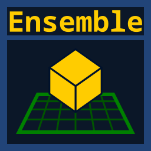
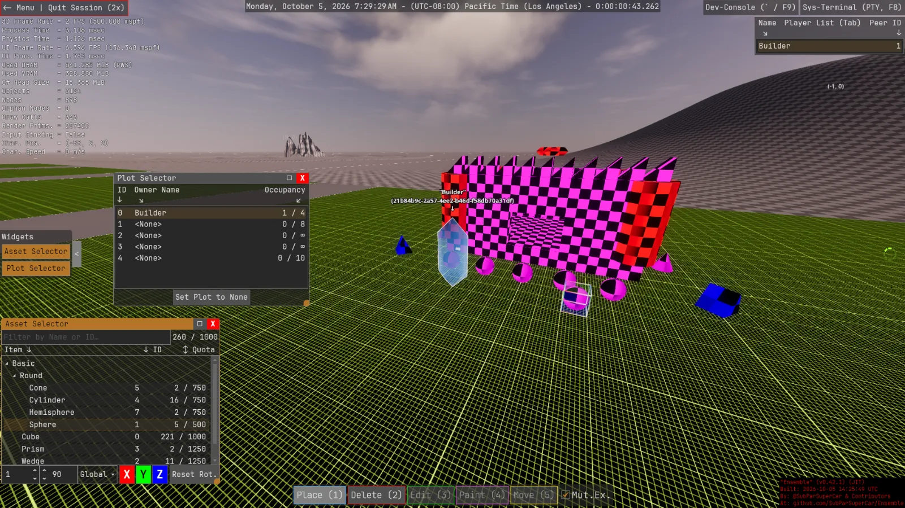
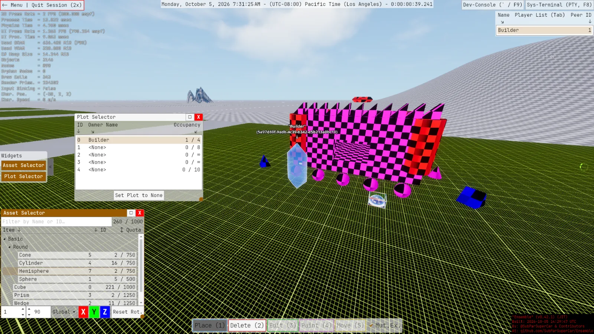
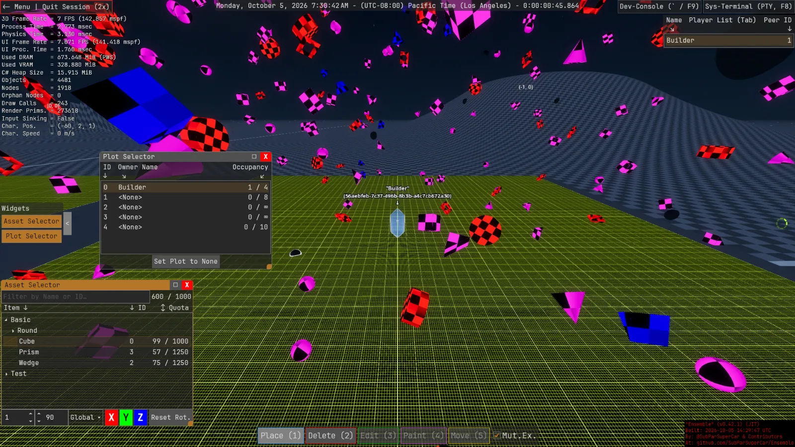

# Ensemble

[](https://github.com/SubParSuperCar/Ensemble/actions/workflows/bin.yml)
[](https://github.com/SubParSuperCar/Ensemble/actions/workflows/src.yml)
[](https://github.com/SubParSuperCar/Ensemble/actions/workflows/cloc.yml)

A free, open-source, multiplayer sandbox building game: claim a plot, grab some shapes, and build something with your
friends. Made with Godot 4, C#, .NET, and Avalonia 12, it is created and maintained by
[**SubParSuperCar**](https://github.com/SubParSuperCar).



> *"Nothing is Arbitrary; Everything is Relative."*<br>
> <small>&mdash; *Ensemble's motto*</small>

<br clear="left"/>

---

> [!NOTE]
> - **Ensemble** is the direct successor to [Baja Builders](https://www.roblox.com/games/85484945236913) on Roblox.
> - Code quality may be "sub-par" (pun intended) as the codebase continues to mature.

> [!WARNING]
> **Ensemble** is in the early stages of development (alpha/pre-release) and should not be considered representative of
> future 1.x or later releases. The project has been open-sourced early to encourage feedback, discussion, and
> contributions while its architecture, systems, and implementation continue to evolve.

---

## Documentation

| Document                                     | What it covers                                                      |
|----------------------------------------------|---------------------------------------------------------------------|
| [**TECHNICAL.md**](./TECHNICAL.md)           | Architecture, subsystems, diagrams, and the repository layout       |
| [**CONTRIBUTING.md**](./CONTRIBUTING.md)     | Setting up a development environment, and the project's conventions |
| [**ROADMAP.md**](./ROADMAP.md)               | What's done, in progress, and planned                               |
| [**LIVE-CREATIONS.md**](./LIVE-CREATIONS.md) | How spawned creations work, and the design for what comes next      |
| [**LICENSE.md**](../LICENSE.md)              | Licensing for the code and the non-code assets                      |

---

## What You Can Do

Everyone gets a plot, and everything you place on it is shared live with everyone else in the session. Build alone in
single-player, or host a session and invite your friends. If you played Baja Builders, you'll feel at home: the ideas
are the same, without Roblox's limits.

- **Build** with blocks, wedges, cylinders, cones, spheres, and more. Pieces snap neatly to the grid and to each other,
  rotate on any axis, and never clip into one another.
- **Bring it to life** by spawning your plot: touching pieces weld together, each piece weighs what its material does,
  and the whole creation tips, falls, and rolls for real, in multiplayer too, with moving parts like springy
  suspensions. Despawn it to keep building.
- **Play together** over the internet or your local network. Hosting can forward its port automatically, so friends can
  join with a single code. Sessions can have passwords and player limits, and run on dedicated servers.
- **Chat** with Roblox-style colored nametags, an optional profanity filter (hosts choose), and an optional "read aloud"
  mode that speaks new messages.
- **Explore** a world with terrain and a full day-night cycle that can follow your real clock.
- **Arrange your screen** with movable, resizable windows (called widgets), in light or dark themes that follow your
  system's accent color.
- **Tinker** with a built-in Lua console, and even a web browser and system terminal inside the game.

Moving parts you can drive (motors, hinges, pistons, and seats), saving and loading creations, a real map, and more
building tools are on the way; see the [**roadmap**](./ROADMAP.md).

---

## Screenshots

<details open>
  <summary>Click to expand/collapse this section.</summary>

> [!NOTE]
> Some of these screenshots may be out of date or not fully representative of the current state of the gameplay.

Two Ensemble clients connected to a headless host with widgets and a Bash pseudo-terminal window opened:


Ensemble's placement tool, its preview, and the Plot Selector and Asset Selector widgets:


Ensemble's main menu:


Ensemble's document file viewer showing Ensemble's `README.md` file:


Ensemble's web browser displaying Ensemble's official GitHub repository page:


Ensemble's blocks during the day with the light-mode UI enabled using the `set_ui_dark_theme_on` Lua function:


Ensemble's console, with the output log on the left and the code editor on the right:


Ensemble's blocks at night, generated using the `loc_add_rand_insts` Lua function:


Ensemble's test map:


</details>

---

## Download

> [!NOTE]
> Ensemble has very little gameplay. These builds exist for testing and feedback.

- **Tagged builds:** the [latest release](https://github.com/SubParSuperCar/Ensemble/releases/latest) has self-contained
  Windows, Linux, and macOS builds. Unzip and run `Ensemble.exe` (Windows), `Ensemble.x86_64` (Linux), or `Ensemble.app`
  (macOS) &mdash; no install, no runtime needed.

- **Latest commit:** run the [Build Binaries](https://github.com/SubParSuperCar/Ensemble/actions/workflows/bin.yml)
  workflow ("Run workflow"; on a fork if you lack write access), then download the artifacts from the finished run.

On startup, Ensemble asks GitHub for the latest release and offers each newer version once. If Discord is running, it
also shares your activity (e.g., "In the Main Menu" or "Playing Multi-Player") without names or addresses.

Each platform provides a lean ZIP and a `-debug` ZIP that also includes symbol files. There is also a single `-jit` ZIP
for testing and troubleshooting; see [**Platform Support**](#platform-support) before choosing it.

> [!IMPORTANT]
> macOS builds need one extra step before they'll open &mdash; see [**Bypassing Gatekeeper on
> macOS**](#bypassing-gatekeeper-on-macos) below.

---

## Playing Together

<details open>
  <summary>Click to expand/collapse this section.</summary>

Multiplayer is host-authoritative and peer-to-host over UDP (ENet). Everyone must run the **same version**. Traffic is
encrypted (DTLS), but players don't verify the host's identity yet, so it stops eavesdropping, not impersonation. A host
password only controls who can join, so don't use one that matters elsewhere.

- **Host:** *Play &rarr; Multi-Player (Online) &rarr; Host (Server)*. Leave the port empty for the default (`7777`), and
  optionally set a password and a client limit. Share your address with joining players:
    - **Same network (LAN):** run `log_lan_ip4_addr()` in the console (`` ` `` / `F9`).
    - **Over the internet:** keep *Auto Forward Port (UPnP)* checked, then copy the join code from under the player list
      (`Tab`; it isn't shown, since it contains your public IP address) and share it. If your router has UPnP disabled,
      or is behind another NAT (e.g., CGNAT), forward the UDP port manually and share the address from
      `log_wan_ip4_addr()` instead.
- **Join:** *Play &rarr; Multi-Player (Online) &rarr; Join (Client)*, then enter the host's address (or host name) and
  port, or a single `<address>:<port>` code.
- **Dedicated server:** run the executable headless with user arguments, e.g.,
  `Ensemble.x86_64 --headless -- --port=7777 --password=abc --max-clients=8` (add `--upnp` to forward the port, or
  `--profanity-filter=false` to turn off the profanity filter). Every argument has a short form, e.g.,
  `--p=7777 --pw=abc` (`j`, `mc`, `n`, `p`, `pf`, `pw`, and `u`). The same arguments work without `--headless`: a
  regular window then hosts as a player (`--port`, with `--name`), or joins (`--join`), instead of opening the menu.

Players who join late receive the current state of every plot. Plot changes, placements, and deletions are synchronized,
and characters are replicated. A spawned creation is simulated by its plot's owner and streamed to everyone else; when
the owner leaves, the next one takes over, and the host steps in if a simulator stops responding. Creations of different
plots that come close share one simulator until they part. To try a poor connection without outside players, run
`set_net_sim(120, 40, 0.05)` (latency and jitter in milliseconds, and a loss rate) on a client. Hosts can list peers
(with their ping) using `dmp_peers()` and remove one using `kick_peer(peer_id, "reason")`, and kick players off plots
with `kick_occupant("name or id")`, which plot owners can also use on their own plots. Display names are remembered
between sessions. The host has authority over the session: they can clear any plot they occupy, and their chat messages
bypass the profanity filter.

Chat happens in the Text Chat widget, which opens in multiplayer: press `/` to type and `Enter` to send. Nametags are
colored per display name, like in Roblox's legacy chat, joins and leaves are announced, and late joiners receive the
recent history. The widget's options can also save each session's chat to `user://chat_logs/` and read new messages
aloud. The console offers `chat("message")`, `dmp_chat()`, `set_chat_log_on(true)`, and `set_chat_tts_on(true)`.

The profanity filter masks profane words in chat (with `#`, or `<Redacted>` if nothing else remains) and gives joining
players with inappropriate display names the default name instead. Hosts choose it in the host menu (on by default and
remembered; dedicated servers take `--profanity-filter=false`), and can toggle it mid-session in the chat's options or
with `set_profanity_filter_on(false)`.

</details>

---

## Controls

<details>
  <summary>Click to expand/collapse this section.</summary>

| Action                                | Binding                                                    |
|---------------------------------------|------------------------------------------------------------|
| Move / run / jump                     | `WASD` or `Up` `Down` / `Shift` / `Space` or `Ctrl`        |
| Orbit / turn / zoom camera            | Right mouse / `Q` `E` or `Left` `Right` / wheel, `I` `O`   |
| Toggle place / delete tool            | `1` / `2`                                                  |
| Place or delete (tool trigger)        | Left mouse                                                 |
| Toggle selection (delete tool)        | `Shift` + left mouse                                       |
| Box-select (delete tool)              | `Alt` + drag (`Shift` toggles, `Esc` cancels)              |
| Rotate placement (X / Y / Z)          | `R` / `T` / `Y`                                            |
| Reset character position              | Hold `H` for 1 second                                      |
| Player list                           | `Tab`                                                      |
| Chat (with the widget open)           | `/` to type, `Enter` to send, `Esc` to stop typing         |
| Console / system terminal             | `` ` `` or `F9` / `F8`                                     |
| Back (menus)                          | `Backspace`                                                |
| Start (or restart) single-player game | `Esc` (outside multiplayer; restarting discards the build) |

The camera also zooms with `-` `=` and `Page Down` `Page Up`, and most actions have gamepad bindings. Run
`dmp_inp_map()` in the console for the full input map, and `help()` for every console function.

</details>

---

## Platform Support

<details open>
  <summary>Click to expand/collapse this section.</summary>

| Platform | Architecture(s)                | Graphics API                                                    |
|----------|--------------------------------|-----------------------------------------------------------------|
| Windows  | `x86_64`                       | Vulkan                                                          |
| Linux    | `x86_64`                       | Vulkan                                                          |
| macOS    | Universal (`x86_64` + `arm64`) | Metal (native, default); Vulkan via MoltenVK renders without UI |

Ensemble renders through [Godot](https://godotengine.org)'s rendering hardware interface, with an embedded [Avalonia
UI](https://avaloniaui.net) overlay on top of it (via a heavily modified fork of
[Estragonia](https://github.com/MrJul/Estragonia); see [**Credits**](#credits)). Both use Vulkan directly on Windows and
Linux. On macOS, both default to Apple's native Metal API. For troubleshooting, setting Godot's
`rendering/rendering_device/driver.macos` project setting to `vulkan` renders the 3D scene through
[MoltenVK](https://github.com/KhronosGroup/MoltenVK) instead, but without the Avalonia UI, since SkiaSharp's macOS
build has no Vulkan support.

Minimum macOS version: **11.0 (Big Sur)** on Intel, **13.0 (Ventura)** on Apple Silicon.

### JIT Build

The regular builds are compiled ahead of time with NativeAOT: fast to start and run, but one download per platform. The
`-jit` ZIP instead runs Ensemble's code on the regular .NET runtime, which compiles it just in time (JIT). It is slower
to start, larger, and **not recommended for playing**, but it bundles both Windows and Linux (`x86_64`) in one download
and keeps every assembly and debug symbol as a separate file, which helps with testing and troubleshooting. It is also a
debug build: `F12` opens Avalonia's developer tools, the UI shows render overlays, and `Pause` deliberately hangs the
main thread to test the watchdog, which then ends the game. Run `Ensemble.exe` (Windows) or `Ensemble.x86_64` (Linux)
from the extracted folder; each uses its own self-contained .NET runtime in its `data_EnsembleGame_<platform>_x86_64`
folder, so keep those folders next to the executables.

### Debug Symbols

NativeAOT stack traces name each method but have no line numbers, so in NativeAOT builds every logged exception is
followed by its `Native frames:` as module offsets (e.g., `EnsembleGame.so+0x7d805b`). The `-debug` ZIPs carry the
matching symbols to turn those into files and lines. Both ZIPs of a version share the same binaries, so offsets logged
by the lean build work too:

- **Linux:** pipe the log through the bundled script, e.g., `./symbolize.sh < log.txt` (needs `addr2line`).
- **Windows:** `llvm-symbolizer --obj=EnsembleGame.dll --relative-address <offset - 1>`, with `EnsembleGame.pdb` beside
  `EnsembleGame.dll`.
- **macOS:** `atos -o EnsembleGame.dylib.dSYM/Contents/Resources/DWARF/EnsembleGame.dylib -l 0 <offset - 1>`.

The `-jit` ZIP needs none of this: its stack traces already include parameter names and line numbers.

### Bypassing Gatekeeper on macOS

> [!NOTE]
> Proper Apple code signing and notarization cost $99/year. Ensemble is free and open-source, so its macOS build is only
> **ad-hoc signed** &mdash; enough for the app to actually run, but not enough for Apple to vouch for it to Gatekeeper.
> This is expected, and isn't a sign that anything is wrong with the build.

Try these in order &mdash; which step you need depends on your macOS version:

1. **Right-click (or Control-click) `Ensemble.app` and choose "Open,"** then click **"Open"** again in the dialog that
   appears. This is usually all it takes.

2. If macOS instead says it **"cannot check it for malicious software"** and doesn't offer an Open button: go to
   **System Settings &rarr; Privacy & Security**, scroll down, and click **"Open Anyway"** next to the mention of
   Ensemble. (You may need to attempt step 1 first for this button to show up.) Confirm once more in the dialog that
   follows.

3. If macOS says `Ensemble.app` **"is damaged and can't be opened"** &mdash; a misleading message Gatekeeper shows for
   unsigned/ad-hoc/non-notarized apps; the download itself isn't actually corrupted &mdash; clear the quarantine flag
   yourself in Terminal:

   ```bash
   xattr -cr /path/to/Ensemble.app
   ```

   Replace the path with wherever you extracted `Ensemble.app`, then try opening it again.

You only need to do this once per downloaded build.

</details>

---

## Naming

*(Pronounced "**EN-sem**-bull," not "ON-som-bull.")*

This game was originally called **Baja Builders** on Roblox from approximately 2022&ndash;2025. However, the name never
really resonated with me, and "baja" can be interpreted as "below" or "low" in Spanish. I ultimately renamed it to
**Ensemble** for two primary reasons:

1. "Ensemble" literally means a group of people, which reflects the game's multiplayer and collaborative nature.
2. It also sounds like "assemble," making it a fitting name for a building game.

---

## Credits

All `OBJ` files under `/assets/meshes/`, except for `plots_base.obj`, were created by **"Shrimp Fried Koishi."** Other
third-party resources, including NuGet packages and files under `/addons/` (Terrain3D, Sky3D, Resonate, and the Rider
plugin) and `/Estragonia/`, are distributed under their respective licenses and are subject to their respective authors'
or copyright holders' terms. The chat's profanity filter uses David Sojevic's
[profanity-list](https://github.com/dsojevic/profanity-list) (MIT; see `/Common/Text/ProfanityList.LICENSE.txt`), with
`allow_partial` set on entries that misfire inside ordinary words. It's stored compressed, so its terms aren't readable
in the source; see `/.github/scripts/profanity-list.sh`. Chat nametag colors use the algorithm from Baja Builders,
Ensemble's Roblox predecessor.

---

## License

Ensemble uses separate licenses for its code and non-code assets:

- **Code:** [**GNU General Public License v3.0 or later**](./LICENSE-CODE.txt)
- **Non-code assets:** [**Creative Commons Attribution-NonCommercial-ShareAlike 4.0
  International**](./LICENSE-ASSETS.txt)

See [**LICENSE.md**](../LICENSE.md) for an overview of the project's licensing.

---

## Contributing

Contributions are welcome. See [**CONTRIBUTING.md**](./CONTRIBUTING.md) to set up a development environment, and
[**TECHNICAL.md**](./TECHNICAL.md) for a map of the codebase.
