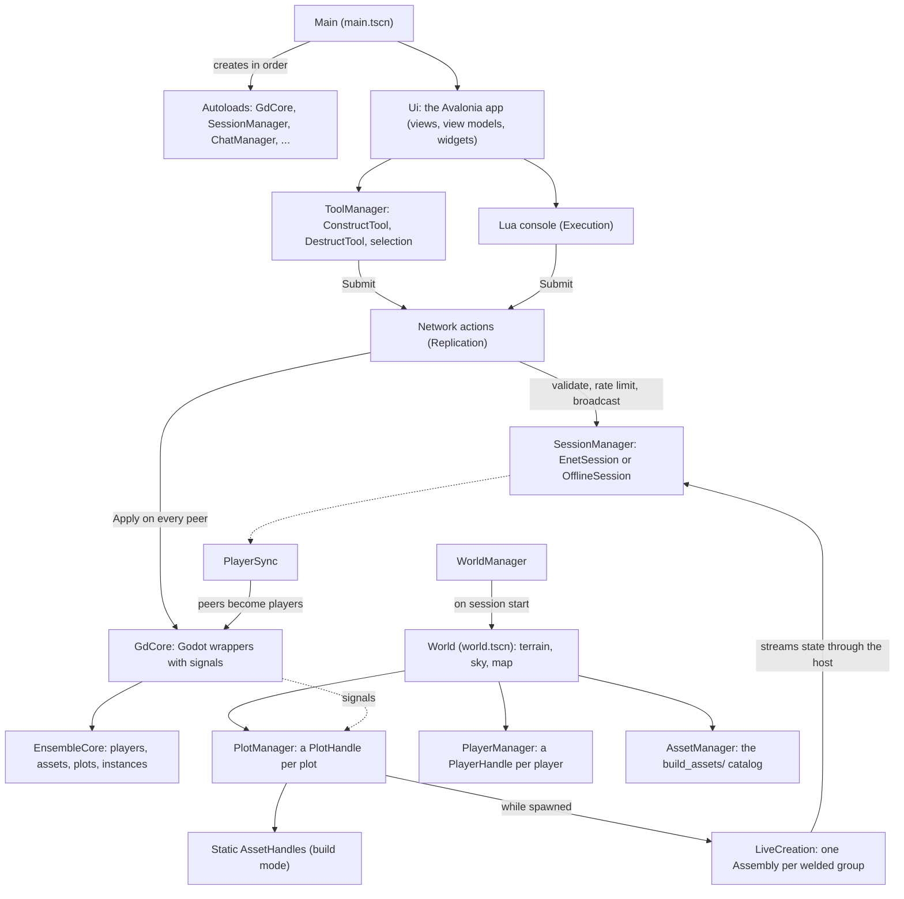
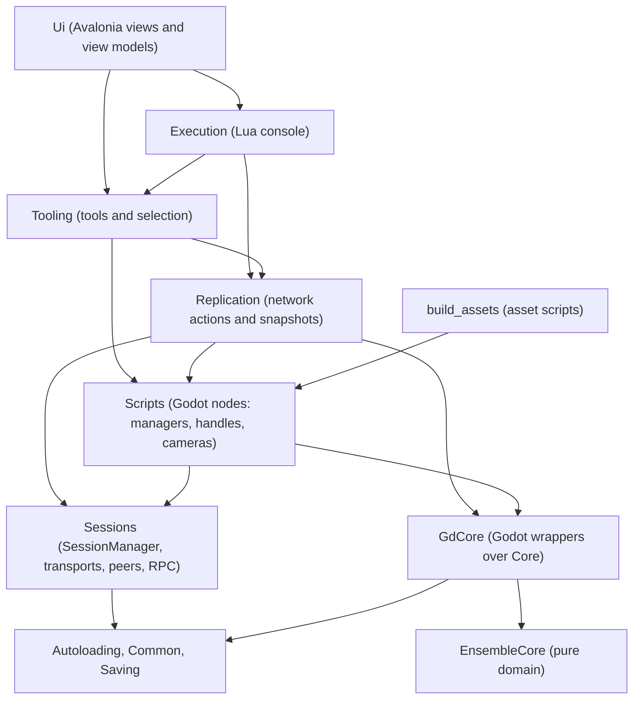
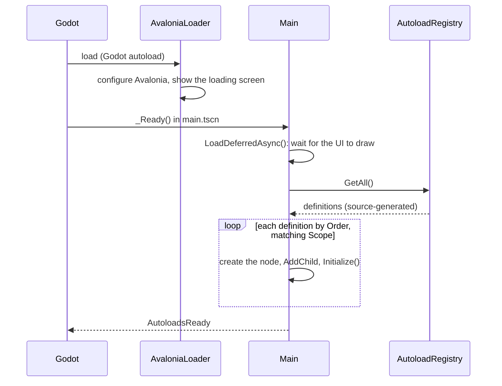
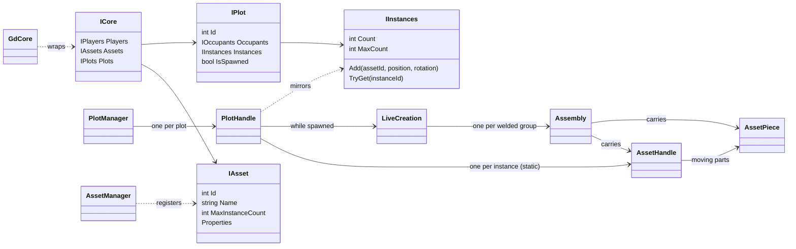
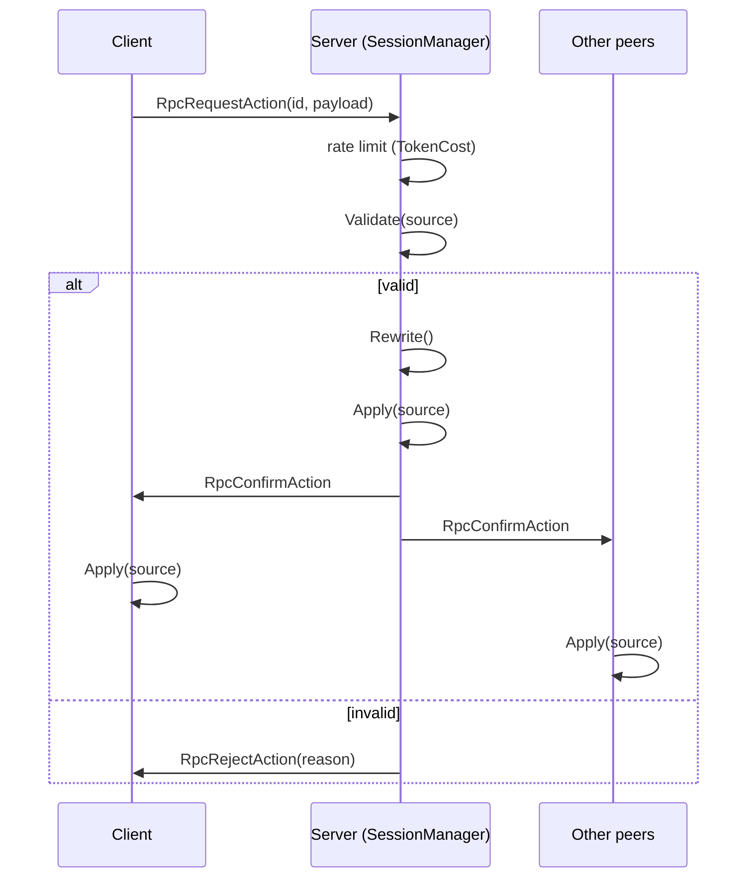
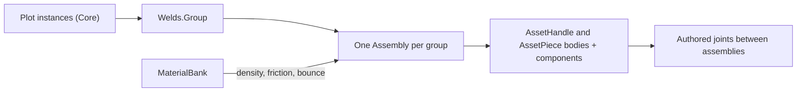
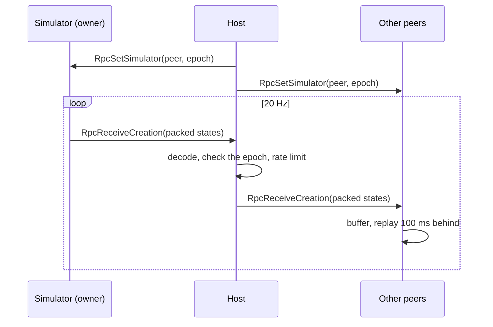
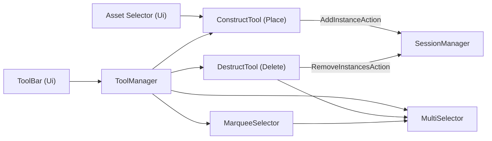

# Ensemble: Technical Overview

How Ensemble is built: its stack, architecture, subsystems, and repository layout. For playing and downloading, see the
[**README**](./README.md); for setting up a development environment, see [**CONTRIBUTING.md**](./CONTRIBUTING.md); for
spawned creations in depth, see [**LIVE-CREATIONS.md**](./LIVE-CREATIONS.md).

> [!NOTE]
> Ensemble moves fast, and this document may trail the code. Where they disagree, the code is right, and the
> document is due a fix.

## Contents

1. [**Stack**](#stack)
2. [**Architecture at a Glance**](#architecture-at-a-glance)
3. [**Module Layering**](#module-layering)
4. [**Startup and Autoloads**](#startup-and-autoloads)
5. [**Scene Tree**](#scene-tree)
6. [**World State: Core, GdCore, and Scripts**](#world-state-core-gdcore-and-scripts)
7. [**Networking: Sessions and Actions**](#networking-sessions-and-actions)
8. [**Live Creations**](#live-creations)
9. [**Tools**](#tools)
10. [**Rendering and Physics**](#rendering-and-physics)
11. [**UI**](#ui)
12. [**Chat and Moderation**](#chat-and-moderation)
13. [**Lua Console and Diagnostics**](#lua-console-and-diagnostics)
14. [**Saving**](#saving)
15. [**Builds and CI**](#builds-and-ci)
16. [**Repository Layout**](#repository-layout)
17. [**Principles**](#principles)

---

## Stack

| Layer          | Technology                                                                         |
|----------------|------------------------------------------------------------------------------------|
| Engine         | Godot 4.7 (.NET build), Mobile rendering method                                    |
| Language       | C# 14 on .NET 10; GDScript only inside third-party addons                          |
| UI             | Avalonia 12 through a forked Estragonia bridge, MVVM with CommunityToolkit.Mvvm    |
| Physics        | Jolt, through Godot's built-in integration, at 100 ticks per second                |
| Networking     | Godot's `SceneMultiplayer` over ENet (DTLS-encrypted), with UPnP port forwarding   |
| Scripting      | Lua 5.2 through LuaCSharp                                                          |
| Logging        | Serilog: console, rolling JSON files, an in-game log view, and toasts for warnings |
| Builds         | NativeAOT with full trimming for releases; a JIT build for testing                 |
| Tests and lint | xUnit v3, NsDepCop layering rules, Meziantou and .NET analyzers                    |
| World addons   | Terrain3D (terrain), Sky3D (sky and day-night cycle), Resonate (audio)             |

---

## Architecture at a Glance

Ensemble is one Godot C# project (`EnsembleGame.csproj`) plus a few sibling projects, all listed in `Ensemble.slnx`:

| Project              | Purpose                                                                         |
|----------------------|---------------------------------------------------------------------------------|
| `EnsembleGame`       | The game itself: everything in this document not covered by the rows below      |
| `EnsembleCore`       | `Core/`: the pure C# domain model (assets, instances, plots, players). No Godot |
| `EnsembleEstragonia` | `Estragonia/`: the Avalonia-in-Godot bridge (forked and maintained here)        |
| `AutoloadGenerator`  | A source generator that builds `AutoloadRegistry` from `[Autoload]` classes     |
| `Tests`              | xUnit v3 tests, run with `dotnet test --solution Ensemble.slnx`                 |

At run time, `Main` creates the autoloads (long-lived services), `WorldManager` loads the world for each session, and
every change to the world flows through validated network actions, even in single-player:



---

## Module Layering

Each top-level folder is a module with its own namespace. Layering is enforced at build time by
[NsDepCop](https://github.com/realvizu/NsDepCop) (`config.nsdepcop`), which reports any forbidden dependency as a build
warning. Simplified, dependencies only point down:



- Only `Ui` may reference `Avalonia.*`, `Estragonia.*`, or `EnsembleRoot.Ui.*`.
- Asset scripts (`EnsembleRoot.BuildAssets.*`, beside their scenes in `build_assets/`) may depend on `Scripts`, but
  nothing in the engine may depend on a concrete asset.
- `Sessions` knows nothing of the game: not `GdCore`, `Scripts`, or Core's domain (only its shared `Guids` and
  `Sentinels`), so the network layer could carry any game.
- `Globals` is cross-cutting. It is imported everywhere through `global using static`, except by the foundation modules:

| Accessor                                          | Returns                                  |
|---------------------------------------------------|------------------------------------------|
| `GMain`                                           | The `Main` node                          |
| `GCore`, `GAssets`, `GPlots`, `GPlayers`          | `GdCore` and its wrappers                |
| `GSessionManager`                                 | The `SessionManager` autoload            |
| `GChatManager`, `GProfanityFilterManager`         | The chat and profanity filter autoloads  |
| `GPlotManager`, `GAssetManager`, `GPlayerManager` | The world's managers in `Scripts`        |
| `GToolManager`                                    | The `ToolManager` autoload               |
| `GTimeProvider`                                   | A wrapped `TimeProvider` (testable time) |

Each accessor throws a descriptive error, rather than returning null, when its target doesn't exist yet. `GContext`
exposes the local player's state (`LocalPlot`, `IsPlotOwner`, `IsLocalPlotSpawned`, each with a change event), and
`Constants` (e.g., `AnimationDuration`, `GameVersion`, `PhysicsLayers`) and Core's `Sentinels` (`Unlimited = -1`,
`None = -1`, `Default = 0`) are imported the same way.

### What Godot Sees

Godot only needs the files that define its script classes, so only each Godot class's main file is visible to it:

- Folders named `Impl/` hold partial classes and plain C# types, hidden from Godot by a `.gdignore` file in each (Godot
  has no global ignore list, so every such folder carries its own). They keep their class's namespace; plain types in
  their subfolders get sub-namespaces (`Scripts/Creations/Impl/Packets/` is `EnsembleRoot.Scripts.Creations.Packets`).
- Pure C# modules (`Core/`, `Common/`, `Saving/`, `Autoloading/`, `Execution/`, `Replication/`, `Globals/`, `Tests/`)
  are hidden whole.
- Every visible script has a committed `.uid` sidecar, which scenes and resources reference.

---

## Startup and Autoloads

Godot's autoload list holds only `AvaloniaLoader` (alongside the Resonate addon's `SoundManager` and `MusicManager`).
Ensemble's own services are classes marked `[Autoload(Order, Scope, FailurePolicy)]`, collected at compile time by
`AutoloadGenerator`. Once the loading screen has drawn, `Main` creates them in order, filtered by scope (a regular
client and/or a headless server), and calls `Initialize()` on those implementing `IAutoload`. Each failure policy
decides what a failure means: log and continue, ask the user, or fail fast.



| Order          | Autoload                 | Scope  | Role                                             |
|----------------|--------------------------|--------|--------------------------------------------------|
| `First`        | `Logger`                 | all    | Serilog setup and sinks                          |
| `Early`        | `GdCore`                 | all    | Owns the Core instance and its Godot wrappers    |
| `Early + 1`    | `SessionManager`         | all    | Single-player / host / join sessions, peers, RPC |
| `Early + 2`    | `PlayerSync`             | all    | Mirrors session peers as GdCore players          |
| `Early + 3`    | `ToolManager`            | client | Creates and gates tools                          |
| `Standard`     | `ChatManager`            | all    | Chat history, logs, and read-aloud               |
| `Standard + 1` | `ProfanityFilterManager` | all    | The host's profanity filter for chat and names   |
| `Standard + 2` | `ExeHasher`              | all    | Logs the executable's path, size, and hash       |
| `Standard + 3` | `DiscordRpc`             | client | Discord Rich Presence                            |
| `Standard + 4` | `DiagnosticLogger`       | all    | Logs a system report in the background           |
| `Late`         | `WorldManager`           | all    | Instantiates the world scene for each session    |
| `Late + 1`     | `UpdateChecker`          | client | Checks GitHub for newer releases                 |
| `Late + 2`     | `CommandLineSession`     | all    | Hosts or joins a session from command-line args  |
| `Last`         | `Watchdog`               | all    | Detects main-thread stalls                       |

---

## Scene Tree

The node tree of a running session, with the scene or script behind each node:

```text
Main                                main.tscn, Main.cs
|- Avalonia UI                      Ui.cs: hosts the Avalonia application
|- Material Bank                    MaterialBank.cs: asset materials (look, density, friction, bounce)
|- Sound Bank                       Resonate's sound events
|- Temporal Static                  a full-screen static effect (hidden by default)
'- (autoloads)                      created by Main in order: Logger, GdCore, SessionManager, ...
   '- WorldManager
      '- World                      world.tscn, WorldHandle.cs (created on session start, freed on stop)
         |- Players                 PlayerManager.cs
         |  '- Player               player.tscn, PlayerHandle.cs (one per player)
         |     |- Character         CharacterBody3D; CharacterController.cs on the local player only
         |     |                    (collider, mesh, nametag, flashlight)
         |     '- PopperCam Boom    poppercam.tscn, PopperCam.cs (local player only)
         |- Asset Registrar         AssetManager.cs: scans build_assets/ for asset scenes
         |- Plots                   PlotManager.cs
         |  '- Plot 1 - 4, Test     plot.tscn, PlotHandle.cs
         |     |- Boundary          the plot's bounds
         |     |- Instances/Static  build mode: one AssetHandle per instance
         |     |- Instances/Dynamic live mode: the LiveCreation while spawned
         |     |- Base              the plot's grid floor
         |     '- Night Light       AreaLight3D
         |- Sky                     Sky3D: sun, moon, and the day-night cycle
         |- Terrain                 Terrain3D
         '- Map                     the base beneath the plots
```

---

## World State: Core, GdCore, and Scripts

State lives in three layers:

- **Core** holds plain data and rules: assets with per-asset instance limits, plots with occupants, an owner, and an
  instance quota, and instances with grid positions, rotations, and properties. It knows nothing of geometry or Godot,
  so it is unit-tested like any plain library.
- **GdCore** wraps Core in `RefCounted` objects with signals, so scene code and the network layer can observe changes.
- **Scripts** turns that into nodes: a `PlotHandle` per plot and an `AssetHandle` per instance, with physics,
  highlights, and outlines, and a `LiveCreation` per spawned plot, which exists only until the plot despawns.



Assets are scenes in `build_assets/`, registered by `AssetManager` on load: each is an `AssetHandle` (a
`StaticBody3D`) with an `AssetId`, a name, default properties, and an instance limit. Its direct colliders are piece 0;
`AssetPiece` children are further pieces that can move on their own. Reusable behaviors are `AssetComponent` nodes
dropped under the handle (such as `Paintable`, which applies the instance's `_colorHex` and `_materialId`), and unique
behaviors subclass `AssetHandle` (such as `Suspension`). Saves store each instance's `AssetId`, so shipped IDs never
change. A collider may sit 1 to 2 mm inside its asset's cell (`MinColliderInset` to `MaxColliderInset`) to keep a face
from welding: `Epsilon`, the distance within which faces touch, is half the narrowest inset, and placement snaps the
asset itself, not its inset colliders, onto the grid.

Placement is validated by shared rules (`PlotPlacement`: bounds, overlaps, and quotas) that run on the client for
previews and on the host for authority. Overlaps are resolved with oriented bounding boxes and the separating axis
theorem over a spatial hash of each plot's boxes, so previews slide out of collisions and snap flush against neighbors.

---

## Networking: Sessions and Actions

`SessionManager` drives one `ISession` transport at a time: `EnetSession` (multiplayer over ENet, which also owns UPnP
through the optional `IPortMappingSession` capability) or `OfflineSession` (single-player). Other transports can be
plugged in through `SessionManager.StartSession(ISession)`. In single-player, the same path runs locally, with the
player acting as the server.

- **Handshake.** Versions must match exactly. Password-protected hosts send a nonce that clients answer with an
  HMAC-SHA256 of the password, so the password never crosses the network. ENet traffic is DTLS-encrypted with the
  host's self-signed certificate, which clients don't verify yet.
- **Identity.** The host assigns every player a GUID and validates display names (alphanumeric, at most 24
  characters), replacing inappropriate ones with the default name when its profanity filter is on.
- **Actions.** Every world change (and chat message) is a `readonly record struct` implementing
  `INetworkAction<TSelf>` with `ToPayload` / `FromPayload`, `Validate`, an optional host-only `Rewrite`, and `Apply`.
  Actions register themselves through module initializers and are sent with `action.Submit()`.
- **Rate limiting.** Each peer has a token bucket of 100 tokens that refills in 5 seconds, and each action costs
  tokens, so costs read as percentages. Requests beyond it queue for up to another bucket's worth, and are then
  rejected with a reason.
- **Late joiners** receive snapshots (plots, instances, and live creations; characters; chat history; the filter
  state) before any further action reaches them, so nothing arrives out of order.
- **Characters** replicate at 20 Hz while moving and once a second while idle, relayed by the host. Each state carries
  the sender's physics-tick sequence, which `StreamTimeline` (shared with live creations) maps to local time, and other
  peers show characters 100 ms in the past, between the buffered states around that moment.



| Action                     | Effect                                           |
|----------------------------|--------------------------------------------------|
| `SetPlotAction`            | Claims or releases a plot for the sender         |
| `SetPlotSpawnedAction`     | Spawns or despawns a plot (owner or host)        |
| `AddInstanceAction`        | Places an asset instance on the sender's plot    |
| `AddInstancesBulkAction`   | Places up to 256 instances with their properties |
| `RemoveInstancesAction`    | Deletes up to 256 instances                      |
| `SetPropertiesAction`      | Changes the properties of up to 256 instances    |
| `ClearInstancesAction`     | Removes every instance on a plot (owner or host) |
| `KickOccupantAction`       | Removes a player from their plot (owner or host) |
| `SendChatMessageAction`    | Posts a chat message (filtered by the host)      |
| `SetProfanityFilterAction` | Toggles the profanity filter (host only)         |

Snapshots (`Replication/Snapshots/`): `PlotsSnapshot`, `CharactersSnapshot`, `ChatSnapshot`, and
`ProfanityFilterSnapshot`.

---

## Live Creations

Spawning (`SetPlotSpawnedAction`) builds the same physics on every peer from the plot's instances, so it sends no
geometry. `PlotHandle` creates a `LiveCreation`, which lives until the plot despawns: it groups touching pieces with
`Welds.Group` (the `Obb.Abuts` face test, then union-find), and builds one `Assembly` (a `RigidBody3D`) per group,
carrying its pieces' collision shapes and mass, with its origin on its center of mass. The pieces' own bodies ride
along outside the physics space, joints authored between an asset's pieces link their assemblies, and the handles and
their components are initialized once the whole creation exists. The static instances stay in sync with Core, only
hidden and disabled while spawned, so despawning is instant.



The host decides who simulates each creation (an override, else the simulator its group shares while it's close to
another plot's creation, else the plot's owner, else itself) and broadcasts every change with an epoch, so late packets
from a previous simulator move nothing. The simulator streams its moving assemblies through the plot; the host checks,
rate limits, and relays each packet, and takes over any creation whose simulator goes silent for 3 seconds; everyone
else moves frozen proxies, which characters can still stand on, along a 100 ms replay of the received states.



Each state packs an assembly's ID, position, rotation, and velocities into 204 bits (`AssemblyState`,
`CreationPackets`, `BitWriter`). Sleeping assemblies are sent once at rest and then only as slow keepalives.
[**LIVE-CREATIONS.md**](./LIVE-CREATIONS.md) walks through all of it, with a map of the code, and holds the design for
what comes next (asset logic, mechanisms, input, and seats).

---

## Tools



- `ToolManager` creates tools lazily and, with `UseMutex`, keeps at most one enabled. Tools can only be enabled while
  the local plot is editable (not spawned), and optionally come back after a despawn (`RestoreOnDespawn`).
- `ConstructTool` shows a translucent preview with an axial highlight, snaps edges (not centers) to the plot grid,
  resolves overlaps with oriented bounding boxes, and supports `RotateX/Y/Z()` and `ResetRotation()` in global or
  local space. A shader material fades only if its `translucent_shader` metadata names a translucent variant of its
  shader with an `opacity` uniform (such as the coil's), so opaque instances never pay for transparency.
- `MultiSelector` holds a selection shared across tools: `Shift`-clicking toggles an instance, clicking a selected
  instance acts on the whole selection, and clicking anything else clears it. `MarqueeSelector` box-selects by
  `Alt`-dragging (Baja Builders parity).
- Highlights (`Scripts/Adornments/`) are box meshes with an edge shader, in two flavors: `AxialHighlight` (per-axis
  colors) and `SolidHighlight` (one tint). They opt out of physics interpolation, as they are placed between physics
  ticks. The local plot's outline rises from its grid in the active tool's color, fading in and out as it moves.

---

## Rendering and Physics

Performance comes first: the game targets very high frame rates on desktop hardware, so fidelity is traded for speed
where the difference is small.

- **Mobile renderer.** Godot's Mobile rendering method, with 4x MSAA and SMAA, and physical light units.
- **Per-vertex shading.** Asset meshes and the map base use per-vertex shading, which is much cheaper with many
  instances. `Paintable` keeps each asset's authored shading when it paints it (one shared material per material,
  color, and shading, so painted geometry still batches). Per-vertex surfaces receive no light from area lights (the
  plots' night lights), nor spot or omni light shadows; directional shadows are still sampled per pixel.
- **Unshaded overlays.** Characters, highlights, and the plot grid are unshaded.
- **Shadows.** The sun uses soft shadow filter quality 3, a shadow blur of 0.75, and a 64 m shadow distance, which
  keeps thin shapes (like the suspension's coil) crisp.
- **`perf_mod()`** trades the rest of the looks for speed, one way: it disables 3D and UI anti-aliasing (including
  terminal windows opened afterward), glow, Sky3D, the terrain, and the plots' night lights and characters'
  flashlights.
- **Jolt physics** at 100 ticks per second on its own thread, with physics interpolation. Layers: 1 World,
  2 Character, 3 Static Instances, and 4 Dynamic Instances (`Constants.PhysicsLayers`). Nodes moved between physics
  ticks (highlights, the placement preview, other players' characters) opt out of interpolation.
- **Terrain collision** is built for the whole terrain up front (Terrain3D's full mode), so bodies far from the local
  character, such as a creation another peer simulates or one a dedicated host takes over, stay on the ground.

---

## UI

The UI is an Avalonia application drawn into a Godot `Control` (`Ui`). The Estragonia fork shares Godot's rendering
device (Vulkan, or native Metal on macOS) and forwards input, focus, clipboard, cursors, and windows between the two.

- **MVVM** with CommunityToolkit.Mvvm's source-generated observable properties and commands. View models derive from
  `ViewModelBase` and are created through dependency injection (`services.Create<T>()`).
- **Self-registration.** Services and view models register themselves through marker interfaces (`ITransientObject`,
  `IScopedObject`, `ISingletonObject`); views bind to view models through `IViewFor<TViewModel>` and
  `ViewLocatorService`.
- **Navigation.** `NavigatorService` handles menu navigation (`GoTo<TViewModel>()`, `GoBack()`).
- **Widgets.** In-game windows (Plot Selector, Asset Selector, Text Chat, Web Browser, Lua Editor, Log Output) are
  widgets (`IWidget` + `WidgetDescriptor`), registered automatically and opened and closed by `WidgetManagerService`;
  they drag, resize, maximize, and reopen where they were.
- **Theming** follows the OS's light or dark mode and accent color, adjusting colors in the Oklab color space to keep
  text readable.
- **Rich tools:** a Markdown document viewer (with Mermaid diagrams) for these docs, a Lua editor with syntax
  highlighting, a native web view, and a pseudo-terminal.
- **Messages.** Code outside `Ui` reaches it only through messages (`Common/Messages/`), such as the Lua console
  changing the UI's scale, theme, or anti-aliasing.

---

## Chat and Moderation

- Chat messages are sanitized (whitespace collapsed, control characters removed, at most 256 characters) and checked
  identically on every peer. Chat lines and read-aloud speech shorten long sender names (default names end in a
  random suffix); everything else keeps the whole name.
- The host's profanity filter matches a compressed word list case-insensitively and through common substitutions (like
  "4" for "a"), while avoiding false positives inside ordinary words. Fully masked messages become `<Redacted>`.
- Join and leave notices are posted locally, late joiners receive recent history, and messages can be logged to
  per-session text files (`user://chat_logs/`) and read aloud with text-to-speech.

---

## Lua Console and Diagnostics

The in-game console (`` ` `` or `F9`) runs Lua through `LuaExecutor.ExecuteAsync`; `help()` lists every function with
its parameters. Scripts get a 5-second blocking budget between yields.

| Group       | Functions                                                                              |
|-------------|----------------------------------------------------------------------------------------|
| App         | `quit`, `restart`, `set_clock_offset`, `tts`, `wait`                                   |
| Building    | `add_inst`, `clr_insts`, `dmp_insts`, `rm_insts`, `set_inst_prop`                      |
| Chat        | `chat`, `dmp_chat`, `set_chat_log_on`, `set_chat_tts_on`, `set_profanity_filter_on`    |
| Diagnostics | `clr_log`, `dmp_asm_info`, `dmp_env`, `dmp_inp_map`, `gc`, `help`, `print`             |
| Display     | `cap_fps`, `dmp_vsync_modes`, `set_ui_dark_theme_on`, `set_ui_scale`, `set_vsync_mode` |
| Network     | `dmp_peers`, `kick_peer`, `log_lan_ip4_addr`, `log_wan_ip4_addr`, `set_net_sim`        |
| Plots       | `dmp_creation`, `kick_occupant`, `set_plot_simulator`, `set_plot_spawned`              |
| World       | `loc_add_rand_insts`, `loc_clr_insts`, `loc_stress_test`, `perf_mod`, `set_sky_time`,  |
|             | `set_static_shader_on`, `tp_char`                                                      |

- **Logging:** Serilog writes colored console output, rolling JSON files, the in-game log view, and toasts for
  warnings.
- **Watchdog:** a background thread fails fast if the main thread stops responding for 20 seconds, instead of hanging
  silently.
- **Startup report:** the OS, hardware, build, and commit are logged at startup, so bug reports carry their context.
- **Stats overlay:** frame and process times, memory, draw calls, and network traffic, in the top-left corner.

---

## Saving

The save format is finished, though the game doesn't use it yet. Creations serialize to a compact binary format (or
JSON), wrapped in an envelope with optional Zstandard or Brotli compression, an optional SHA-256 checksum, and optional
AES-256-GCM encryption keyed with Argon2id. Readers reject corrupt data and bound the file size, the decompressed size,
and every count and string, so a malicious file can't exhaust memory. Loading favors recovery: unknown assets, capped
instances, and invalid property values are skipped and counted, never rejecting a whole save. Separate layout and
content versions leave room to migrate old saves.

---

## Builds and CI

- **Release builds** are NativeAOT-compiled and fully trimmed per platform: Windows and Linux (`x86_64`) and macOS
  (universal), each with a lean ZIP and a `-debug` ZIP carrying symbols. `GdIgnore/PatchExport.cs` flattens the export
  layout at first launch.
- **A JIT build** bundles Windows and Linux in one download, with every assembly as a separate file, for testing.
- **CI** (GitHub Actions): `bin.yml` builds every tag (or on demand), runs the tests in the JIT build's configuration
  (without blocking the release), smoke-tests the Linux package by booting a headless server, and publishes a release
  with checksums; `src.yml` publishes source archives, and `cloc.yml` tracks
  lines of code. Dependabot keeps packages and actions current.
- **Updates:** the game checks GitHub for newer releases on startup and offers each one once.

---

## Repository Layout

| Path                    | Contents                                                                                 |
|-------------------------|------------------------------------------------------------------------------------------|
| `Main.cs`               | The root node: boot, autoload creation, and shutdown                                     |
| `Core/`                 | `EnsembleCore`: the pure domain model (players, assets, instances, plots). No Godot      |
| `GdCore/`               | `RefCounted` wrappers that expose Core to Godot code, signals, and the network           |
| `Sessions/`             | `SessionManager`: transports, handshake, peers, RPCs, and action and snapshot registries |
| `Replication/`          | The game's concrete network actions and snapshots                                        |
| `Scripts/`              | Scene-tree nodes: the world, plots, live creations, assets, players, chat, and more      |
| `build_assets/`         | The placeable asset scenes, by category, with asset scripts beside them                  |
| `Tooling/`              | The building tools, selection, and their manager                                         |
| `Execution/`            | The Lua console's executor and functions                                                 |
| `Ui/`                   | The Avalonia views, view models, widgets, controls, and services                         |
| `Globals/`              | Globally imported accessors, constants, and local-player context                         |
| `Common/`               | Shared utilities: text, audio, input, bit codecs, logging, time, and UI messages         |
| `Saving/`               | The save format and pipeline                                                             |
| `Autoloading/`          | The `[Autoload]` attribute, orders, scopes, and failure policies                         |
| `AutoloadGenerator/`    | The source generator behind `AutoloadRegistry`                                           |
| `Estragonia/`           | The Avalonia-in-Godot bridge (forked and maintained here)                                |
| `Tests/`                | Unit tests for Core, saving, geometry, welds, placement, chat text, and more             |
| `scenes/`               | The main, world, plot, player, and camera scenes                                         |
| `shaders/`              | Highlight, helix, and static-effect shaders                                              |
| `assets/`, `resources/` | Meshes, images, audio, materials, and terrain data                                       |
| `addons/`               | Third-party Godot addons: Terrain3D, Sky3D, Resonate, and the Rider plugin               |
| `GdIgnore/`             | Build-only code kept from Godot (`PatchExport`)                                          |
| `Properties/`           | Launch settings and the launch / side-by-side scripts                                    |
| `.github/`              | These docs, screenshots, helper scripts, and the CI workflows                            |

---

## Principles

- **Canonical over clever.** Prefer the idiomatic, least-surprising solution, and keep it consistent everywhere.
- **Structure first.** Systems get clean boundaries before they get features, so features don't turn into a tangle.
- **Performance matters.** Measure, keep hot paths in C# rather than Godot interop, and trade fidelity for speed where
  the difference is small.
- **Generic parts, specific callers.** Reusable components stay neutral; whoever uses them decides the specifics.
- **Nothing silent.** Failures are logged or shown, and background tasks never fail unobserved.
- **Tidy by default.** ASCII-only sources, 120-column lines, minimal comments that explain *why*, and zero build
  warnings.
